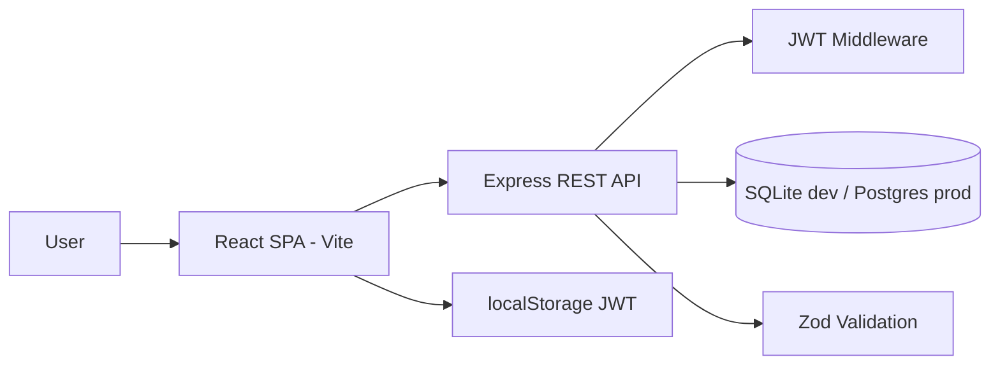
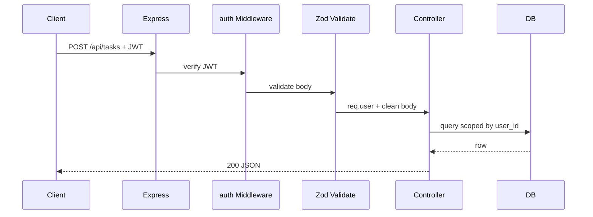

# Todo / Task Manager — Architecture Plan

> Stack: React + Node/Express + SQLite → Postgres | Scope: Basic CRUD + Due Dates + Simple Auth

## 1. Requirements Summary

### Confirmed Scope
- **Tasks**: create, edit, delete, complete/uncomplete (toggle)
- **Due dates**: optional date field per task, overdue indicator
- **Simple auth**: register, login, logout; each user sees only their tasks
- **Out of scope for v1**: lists/projects, tags, priority, sharing, drag-drop, reminders, attachments

### User Stories (MVP)
- As a user I can register with email + password and log in
- As a logged-in user I can CRUD my tasks
- As a user I can mark a task complete/incomplete
- As a user I can set/clear a due date and see overdue tasks highlighted
- As a user I can filter: All / Active / Completed
- As a user I stay logged in across reloads until logout/expiry

### Non-Functional
- Responsive (mobile + desktop)
- SQLite for local/dev, Postgres for prod (via `DATABASE_URL` switch)
- REST JSON API, JWT auth
- Minimal deploy: one frontend static build + one backend service

---

## 2. High-Level Architecture



**Workspace shape** (monorepo recommended for simplicity):

```
./
├── client/                 # React Vite app
│   ├── src/
│   │   ├── pages/         # Login, Register, Dashboard
│   │   ├── components/    # TaskForm, TaskItem, TaskList, Header, FilterBar
│   │   ├── hooks/         # useAuth, useTasks
│   │   ├── api/           # axios/fetch client
│   │   ├── store/         # Context or Zustand
│   │   └── App.tsx + main.tsx
│   └── package.json
├── server/                # Express app
│   ├── src/
│   │   ├── routes/        # auth.routes.ts, tasks.routes.ts
│   │   ├── controllers/   # auth.controller.ts, tasks.controller.ts
│   │   ├── middleware/    # auth.ts, errorHandler.ts, validate.ts
│   │   ├── db/            # db.ts, migrate.ts, schema.sql
│   │   ├── models/        # user.model.ts, task.model.ts
│   │   ├── utils/         # jwt.ts, hash.ts
│   │   └── index.ts
│   └── package.json
├── plans/todo-task-manager-plan.md
└── README.md
```

**Alternative (single package)**: keep `client` and `server` as top-level folders under one `package.json` with `npm --workspace`. Prefer monorepo with two `package.json` for clean separation.

### Tech Choices & Versions
- **Frontend**: React 18 + Vite + React Router 6 + Axios + React Hook Form + Zod (shared validation)
- **State**: React Context + `useReducer` or Zustand (lightweight, no Redux needed for basic CRUD)
- **Backend**: Node 20 LTS + Express 4 + TypeScript + Zod + bcrypt + jsonwebtoken + cors + dotenv + helmet
- **DB**: `better-sqlite3` for dev, `pg` for prod; abstracted behind `db.ts` interface. ORM optional: raw SQL + lightweight query helper, or Prisma (SQLite provider → Postgres later, single schema)
- **Lint/Format**: ESLint + Prettier, TypeScript strict

---

## 3. Data Model

### ER Diagram

```mermaid
erDiagram
    users ||--o{ tasks : owns
    users {
        int id PK
        string email UK
        string password_hash
        datetime created_at
    }
    tasks {
        int id PK
        int user_id FK
        string title
        string description
        boolean completed
        date due_date nullable
        datetime created_at
        datetime updated_at
    }
```

### SQL Schema (SQLite compatible, Postgres compatible with minor type tweaks)

```sql
-- users
CREATE TABLE users (
  id INTEGER PRIMARY KEY AUTOINCREMENT,
  email TEXT NOT NULL UNIQUE,
  password_hash TEXT NOT NULL,
  created_at TEXT NOT NULL DEFAULT (datetime('now'))
);

-- tasks
CREATE TABLE tasks (
  id INTEGER PRIMARY KEY AUTOINCREMENT,
  user_id INTEGER NOT NULL REFERENCES users(id) ON DELETE CASCADE,
  title TEXT NOT NULL CHECK (length(title) > 0 AND length(title) <= 200),
  description TEXT NOT NULL DEFAULT '',
  completed INTEGER NOT NULL DEFAULT 0, -- 0/1 for SQLite, boolean for Postgres
  due_date TEXT, -- ISO 8601 date string YYYY-MM-DD or null
  created_at TEXT NOT NULL DEFAULT (datetime('now')),
  updated_at TEXT NOT NULL DEFAULT (datetime('now'))
);
CREATE INDEX idx_tasks_user_id ON tasks(user_id);
CREATE INDEX idx_tasks_completed ON tasks(completed);
```

**Prisma alternative** (if chosen): single `schema.prisma` with `provider = "sqlite"` initially, `datasource` swapped to `postgresql` via env.

---

## 4. API Contract

Base URL: `/api`

### Auth

| Method | Path | Body | Auth | Response |
|--------|------|------|------|----------|
| POST | `/api/auth/register` | `{email, password}` | No | `201 {user, token}` |
| POST | `/api/auth/login` | `{email, password}` | No | `200 {user, token}` |
| GET | `/api/auth/me` | — | Yes | `200 {user}` |

- Password rules: min 8 chars
- Token: JWT `expiresIn: 7d`, payload `{userId, email}`, secret from `JWT_SECRET` env
- Client stores token in `localStorage` + sends `Authorization: Bearer <token>`

### Tasks (all require Auth header, scoped to current user)

| Method | Path | Body / Query | Response |
|--------|------|--------------|----------|
| GET | `/api/tasks` | `?filter=all|active|completed` optional | `200 Task[]` |
| GET | `/api/tasks/:id` | — | `200 Task` |
| POST | `/api/tasks` | `{title, description?, due_date?}` | `201 Task` |
| PUT | `/api/tasks/:id` | `{title?, description?, due_date?, completed?}` | `200 Task` |
| PATCH | `/api/tasks/:id/toggle` | — | `200 Task` (convenience) |
| DELETE | `/api/tasks/:id` | — | `204` |

**Task shape**:

```ts
type Task = {
  id: number;
  user_id: number;
  title: string;
  description: string;
  completed: boolean;
  due_date: string | null; // ISO date "2026-11-14"
  created_at: string;
  updated_at: string;
}
```

**Error format** (consistent):

```json
{ "error": { "message": "Task not found", "code": "NOT_FOUND", "details": [] } }
```

Status codes: 400 validation, 401 unauth, 403 forbidden (wrong owner), 404 not found, 409 email taken.

---

## 5. Frontend Plan

### Routes

| Path | Component | Guard |
|------|-----------|-------|
| `/login` | `LoginPage` | redirect if authed |
| `/register` | `RegisterPage` | redirect if authed |
| `/` | `DashboardPage` | require auth |
| `*` | `NotFound` | — |

### Component Breakdown

```
App
├── AuthProvider (Context: user, token, login, logout)
├── Header (app title, user email, logout)
├── DashboardPage
│   ├── TaskForm (create; doubles as edit inline)
│   ├── FilterBar (All | Active | Completed + count badges)
│   ├── TaskList
│   │   └── TaskItem (title, description, due_date badge, overdue, checkbox, edit/delete)
│   └── EmptyState
└── LoginPage / RegisterPage (form + error display)
```

### State Management

- `AuthContext`: `{user, token, login, register, logout, loading}` — token persisted to localStorage
- `Tasks`: fetch on mount, optimistic toggle/delete, revalidate on mutation. Option A: local state + `useEffect` calling `api/tasks`. Option B: Zustand store `useTaskStore`. No need for React Query in v1 but recommended if time allows.

### API Client

`client/src/api/client.ts`:
- axios instance baseURL `/api`, interceptor attaches `Authorization`
- on 401 → clear storage → redirect `/login`

### UX Details
- Inline edit: click pencil → TaskForm prefilled → save/cancel
- Due date: `<input type="date">`, display relative (Today, Overdue, In 3 days)
- Completed tasks visually muted + strikethrough
- Form validation (Zod): title required 1–200 chars, due_date valid date or null
- Loading skeletons, error toasts

---

## 6. Backend Plan

### Request Flow



### Layering

- **routes**: thin, wire middleware → controller
- **controllers**: handle req/res, call models
- **models**: SQL queries, map DB rows → domain types
- **middleware**: `authenticate`, `validate(schema)`, `errorHandler`, `notFound`
- **utils**: `hashPassword`, `comparePassword`, `signToken`, `verifyToken`

### Validation (Zod schemas, shared if monorepo)

```ts
registerSchema = z.object({ email: z.string().email(), password: z.string().min(8) })
createTaskSchema = z.object({ title: z.string().min(1).max(200), description: z.string().max(2000).optional(), due_date: z.string().regex(/^\d{4}-\d{2}-\d{2}$/).nullable().optional() })
updateTaskSchema = createTaskSchema.partial().extend({ completed: z.boolean().optional() })
```

### Security Middleware Stack

```ts
app.use(helmet());
app.use(cors({ origin: process.env.CLIENT_URL || "http://localhost:5173" }));
app.use(express.json({ limit: "10kb" }));
```

### DB Abstraction

`server/src/db/db.ts` exports `query`, `get`, `run` helpers; implementation switches on `DATABASE_URL` prefix (`sqlite:` vs `postgres://`). Keeps controllers DB-agnostic.

---

## 7. Auth, Validation & Security

- **Password**: bcrypt cost 10, never log or return `password_hash`
- **JWT**: HS256, secret min 32 chars, 7d expiry, refresh not needed for MVP
- **Authorization**: every task query includes `WHERE user_id = req.user.id`; return 404 (not 403) to avoid leaking existence
- **Input**: Zod on backend (authoritative) + also on frontend for instant feedback
- **Rate limit** (optional v1.1): `express-rate-limit` on `/api/auth/*`
- **CORS**: allow only frontend origin
- **Env**: `PORT`, `JWT_SECRET`, `DATABASE_URL`, `CLIENT_URL`, `NODE_ENV`

---

## 8. Testing Strategy

| Layer | Tool | What |
|-------|------|------|
| Backend unit | Vitest | models, utils (hash, jwt) |
| Backend API | Vitest + Supertest | auth & tasks routes (happy + auth failure + validation) |
| Frontend unit | Vitest + Testing Library | TaskItem, TaskForm, FilterBar |
| E2E (optional v1.1) | Playwright | register → create task → complete → filter → logout |

Coverage target: 70%+ for server.

---

## 9. Deployment & CI/CD

### Option A — Simple (recommended for MVP)
- **Frontend**: Vercel / Netlify static (build `vite build` → `dist`)
- **Backend**: Render / Railway / Fly.io Node service; Postgres add-on; `DATABASE_URL` points to Postgres
- Env vars set in dashboards

### Option B — Single VM/Docker
- `Dockerfile` multi-stage: build client → copy to `server/public` → serve via Express `express.static`
- `docker-compose.yml`: `app` + `postgres` + `volume`

### CI (GitHub Actions)
```yaml
on: [push, pull_request]
jobs:
  test:
    runs-on: ubuntu-latest
    steps:
      - uses: actions/checkout@v4
      - uses: actions/setup-node@v4
      - run: npm ci && npm test (server & client)
      - run: npm run build
```

### Migration Path SQLite → Postgres
- Keep SQL Postgres-compatible (use `TEXT`/`TIMESTAMP`, avoid SQLite-only quirks)
- On switch: run `migrate.ts` to create tables in Postgres; if data to preserve, dump SQLite → import

---

## 10. Milestones & Build Order

1. **Scaffold** — Vite React + Express TS, ESLint, env, hello routes
2. **Auth backend** — users table, register/login/me, JWT middleware
3. **Auth frontend** — Login/Register pages, AuthContext, protected route
4. **Tasks backend** — tasks table, CRUD + toggle, filter query
5. **Tasks frontend** — Dashboard, TaskForm, TaskList/Item, FilterBar
6. **Polish** — due-date UX, overdue, validation, error toasts, empty/loading states
7. **Tests + Deploy** — add tests, choose host, deploy, verify

---

## 11. Open Decisions for User to Confirm

- **DB for v1**: SQLite (file) or Postgres via Docker? Plan supports both.
- **ORM**: Raw SQL helpers (lighter) or Prisma (nicer DX, one schema to switch providers)?
- **State**: Context (zero deps) or Zustand (cleaner for tasks)?
- **Hosting preference**: Vercel+Render vs single Docker deploy?

---

## 12. What Code Mode Will Deliver

On approval, Code mode will create the scaffolding, implement milestones 1–6, and leave tests/deploy as follow-ups — all runnable locally with `npm run dev` (client on 5173, server on 3000, proxy `/api`).

